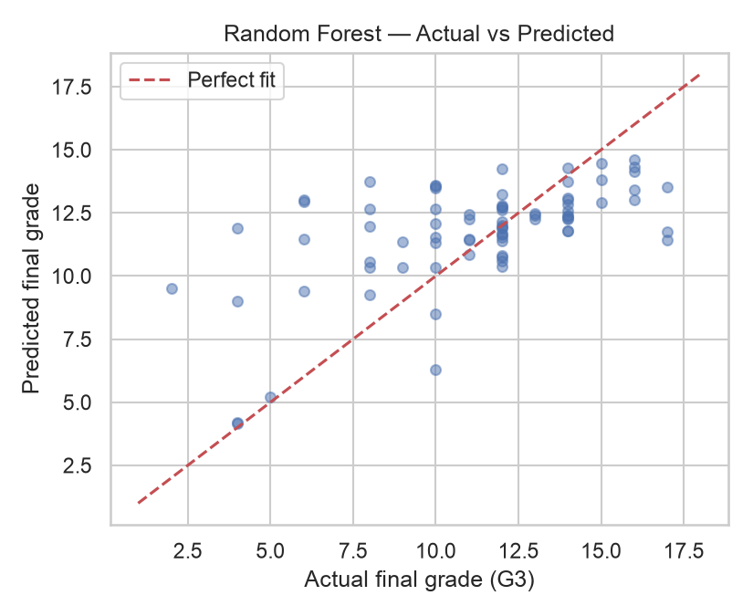
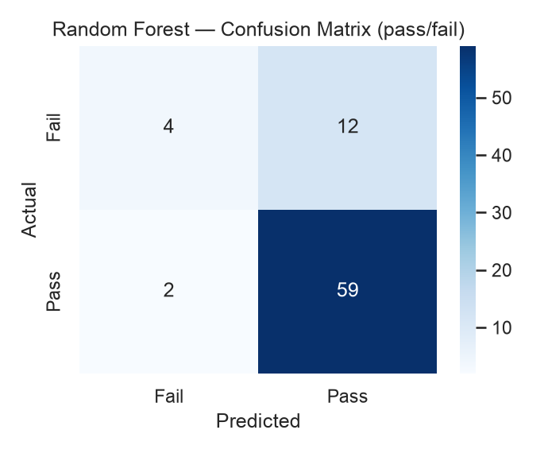
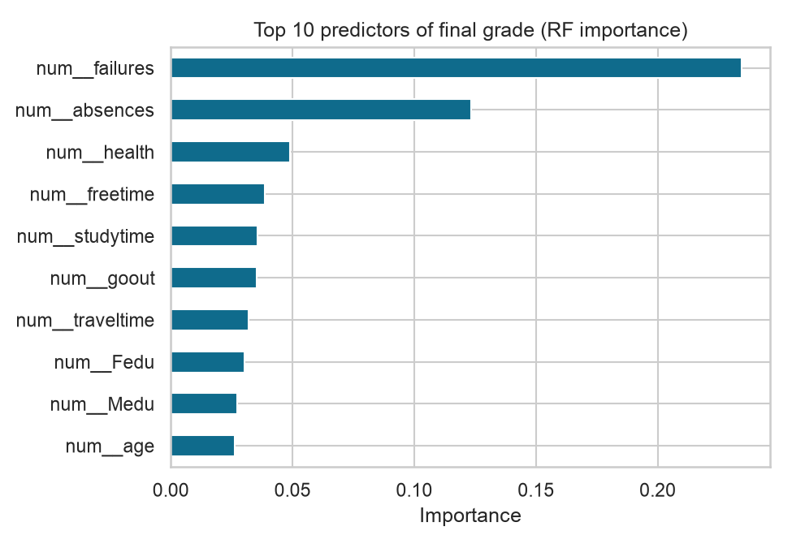

# 🎓 Student Performance Prediction

End-to-end machine learning project that predicts a secondary school student's **final grade (G3)** and **pass/fail outcome** using only demographic, social and school-related attributes — with a local Streamlit demo.

📊 **Dataset:** [UCI Student Performance](https://archive.ics.uci.edu/ml/datasets/student+performance) (Cortez & Silva, 2008) · 382 students who attended both math & Portuguese courses (canonical merge from the original study)

---

## Run the Streamlit app locally

```bash
pip install -r requirements.txt
streamlit run app/app.py
```

Input a student profile (study time, absences, family support, alcohol habits…) and get an instant **pass/fail prediction with probability**, plus intervention advice.



---

## 📈 Results

### Classification — predict pass/fail (G3 ≥ 10)

| Model | Accuracy | Pass precision | Pass recall | Pass F1 | ROC-AUC |
|---|---|---|---|---|---|
| **Random Forest** | **81.8%** | **83.1%** | **96.7%** | **0.894** | **0.704** |
| Logistic Regression | 76.6% | 80.3% | 93.4% | 0.864 | 0.661 |

5-fold CV ROC-AUC (Random Forest): **0.68 ± 0.09**



### Regression — predict final grade G3 *(without prior grades)*

| Model | R² | RMSE | MAE |
|---|---|---|---|
| **Random Forest** | **0.34** | **2.77** | **2.03** |
| Linear Regression | 0.09 | 3.26 | 2.45 |



> **Why no G1/G2?** Previous grades are measured *during* the school year, minutes away from the final exam. Including them would leak the answer — we deliberately predict from social/demographic signals only, which is the genuinely hard (and honest) version of this problem.

---

## 🧪 Reproducibility

```bash
# full pipeline: data -> models -> metrics -> plots
python src/models.py

# open the full analysis notebook
jupyter notebook notebooks/01-eda-and-modeling.ipynb
```

### Artifacts

| Path | What |
|---|---|
| `src/data.py` | Loading, canonical merge, feature engineering |
| `src/models.py` | Training + evaluation pipeline (both tasks) |
| `notebooks/01-eda-and-modeling.ipynb` | Executed EDA & modeling walkthrough |
| `app/app.py` | Streamlit interactive predictor |
| `models/` | Serialized best models (joblib) |
| `reports/metrics.json` | All metrics, machine-readable |
| `reports/classification_report.txt` | Full classification report |
| `images/` | Plots used above |

---

## Limitations and next experiment

At the default threshold, the random forest flagged 4 of 16 failing students and missed 12. It also flagged 2 of 61 passing students. The 96.7% recall in the table describes the Pass class. For an early-warning use case, tune the threshold on a validation set and compare missed failures with false alarms on separate test data.

## 📚 References

- Cortez, P. & Silva, A. (2008). *Using Data Mining to Predict Secondary School Student Performance*. Proceedings of 5th FUture BUsiness TEChnology Conference.
